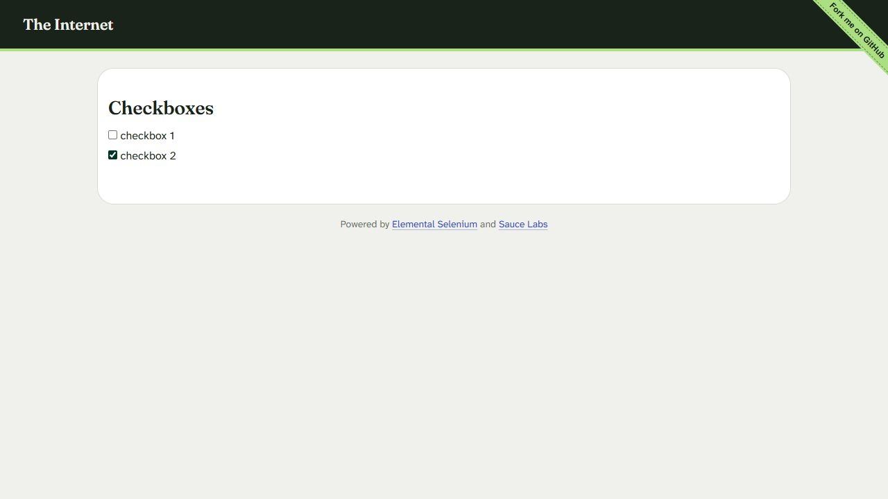

# Практическая работа №1

**Тема:** разработка рабочей тестовой документации.

## Общая информация

| Параметр | Значение |

| Объект | The Internet, раздел Checkboxes |
| Адрес | <https://the-internet.herokuapp.com/checkboxes> |
| Активность | Функциональное тестирование, GUI и управление с клавиатуры |
| Окружение | Windows; браузер; снимок области страницы 1280 × 720 px |

## 1. Цель работы

Разработать Checklist, Acceptance Sheet и Test Cases для веб-приложения, выполнить проверки и зафиксировать обнаруженные несоответствия.

### Выбор приложения и границы проверки

Основной вариант из задания — определение типа треугольника по адресу <https://playground.learnqa.ru/puzzle/triangle>. При открытии браузер вернул `net::ERR_CERT_DATE_INVALID`; функциональные проверки этого приложения не выполнялись. Использован предусмотренный методичкой альтернативный вариант: The Internet → Checkboxes.

Раздел содержит два независимых флажка с подписями `checkbox 1` и `checkbox 2`. Проверяются исходные состояния, переключение мышью и пробелом, независимость выбора, переход Tab, действие подписей и повторная загрузка. Внешние ссылки, другие разделы сайта, мобильные браузеры, масштабирование, работа без JavaScript, очистка cookies и кэша в область выполненных проверок не входят. Кроссбраузерное тестирование не проводилось.

Основание ожиданий: практическое задание и базовые проверки чекбоксов из методички. В частности, переключение кликом по тексту подписи рассматривается как критерий удобства использования из учебного задания. Отдельной спецификации продукта не предоставлено. Начальные значения `0, 1` зафиксированы при первом открытии и используются как базовое состояние для проверки повторной загрузки. Сохранение пользовательского выбора между загрузками не заявлено, поэтому его сброс сам по себе дефектом не считается.

Обозначение пары состояний: `(первый флажок, второй флажок)`; `0` — снят, `1` — установлен. `Pass` — ожидаемый результат получен; `Fail` — получен другой результат; `Not run` — проверка не выполнялась. Глубина: `Smoke` — базовая работоспособность, `MAT` — основные сценарии, `AT` — расширенные проверки. Эта трактовка используется в отчете; в методичке сокращения не расшифрованы.

## 2. Checklist

**Модуль:** Checkboxes.

| № | Проверка | Статус | Примечание |
| --- | --- | --- | --- |
| CL-01 | Страница открывается; заголовок Checkboxes и два флажка видны | Pass | TC-01 |
| CL-02 | Подписи читаемы, элементы не перекрываются | Pass | Визуально при 1280 × 720; [снимок](evidence/checkboxes.png) |
| CL-03 | При открытии первый флажок снят, второй установлен | Pass | TC-01; исходная пара `(0, 1)` |
| CL-04 | Клик по первому квадрату устанавливает первый флажок | Pass | TC-02 |
| CL-05 | Клик по второму квадрату снимает второй флажок | Pass | TC-03 |
| CL-06 | Повторный клик по первому квадрату снимает первый флажок | Pass | TC-04 |
| CL-07 | Изменение одного флажка не меняет второй | Pass | TC-02–TC-04; просмотрены все четыре комбинации |
| CL-08 | Пробел переключает первый флажок с фокусом | Pass | TC-05 |
| CL-09 | Tab переводит фокус с первого флажка на второй | Pass | TC-06 |
| CL-10 | Пробел переключает второй флажок с фокусом | Pass | TC-07 |
| CL-11 | Клик по подписи checkbox 1 переключает первый флажок | Fail | TC-08; BUG-01 |
| CL-12 | Клик по подписи checkbox 2 переключает второй флажок | Fail | TC-09; BUG-01 |
| CL-13 | После повторной загрузки исходное состояние воспроизводится | Pass | TC-10; `(0, 1)` |
| CL-14 | Верстка сохраняется при узком окне и изменении масштаба | Not run | Дополнительная проверка вне выполненной сессии |

Итого: 14 пунктов, 11 Pass, 2 Fail, 1 Not run. Пункты чеклиста могут покрываться одними и теми же тест-кейсами; это не число независимых прогонов.

## 3. Acceptance Sheet

**Модуль:** Checkboxes. Таблица перечисляет области приемки, подробные действия приведены в тест-кейсах. Для всех строк указана глубина AT согласно методичке. Статус области отражает только выполненные проверки; наличие Not run не позволяет считать всю область принятой.

| № | Функция / элемент | Глубина | Статус | Покрытие |
| --- | --- | --- | --- | --- |
| AS-01 | Открытие раздела | AT | Pass | TC-01 |
| AS-02 | GUI: заголовок, флажки и подписи | AT | Not run | CL-02 выполнен; CL-14 не выполнен |
| AS-03 | General: фокус и управление клавиатурой | AT | Pass | TC-05–TC-07 |
| AS-04 | Первый флажок | AT | Pass | TC-02, TC-04, TC-05 |
| AS-05 | Второй флажок | AT | Pass | TC-03, TC-07 |
| AS-06 | Независимый множественный выбор | AT | Pass | TC-01–TC-04 |
| AS-07 | Текстовая подпись первого флажка | AT | Fail | TC-08; BUG-01 |
| AS-08 | Текстовая подпись второго флажка | AT | Fail | TC-09; BUG-01 |
| AS-09 | Инициализация после повторной загрузки | AT | Pass | TC-10 |

## 4. Test Cases

Общий адрес для всех кейсов: <https://the-internet.herokuapp.com/checkboxes>. Каждый кейс воспроизводим отдельно: при необходимости сначала открыть страницу и кликами непосредственно по квадратам привести состояния к указанной паре. Указанные фактические результаты получены в ходе одной последовательной сессии, а не перенесены из примера отчета.

### TC-01. Открытие страницы

| Поле | Описание |
| --- | --- |
| Глубина | Smoke |
| Предусловия | Браузер открыт, доступ к сети есть |
| Данные | URL раздела Checkboxes |
| Шаги | 1. Открыть URL. 2. Проверить заголовок, количество флажков и их состояния |
| Ожидаемый результат | Страница загружена, видны заголовок Checkboxes и два флажка |
| Фактический результат | Заголовок и два флажка видны; зафиксировано исходное состояние `(0, 1)` |
| Постусловия | Страница открыта, состояния `(0, 1)` |
| Статус | Pass |

### TC-02. Установка первого флажка мышью

| Поле | Описание |
| --- | --- |
| Глубина | Smoke |
| Предусловия | Страница открыта, состояния `(0, 1)` |
| Данные | Первый квадрат флажка |
| Шаги | 1. Нажать непосредственно на квадрат первого флажка. 2. Проверить оба состояния |
| Ожидаемый результат | `(1, 1)`; второй флажок не изменился |
| Фактический результат | `(1, 1)` |
| Постусловия | Оба флажка установлены |
| Статус | Pass |

### TC-03. Снятие второго флажка мышью

| Поле | Описание |
| --- | --- |
| Глубина | MAT |
| Предусловия | Страница открыта, состояния `(1, 1)` |
| Данные | Второй квадрат флажка |
| Шаги | 1. Нажать непосредственно на квадрат второго флажка. 2. Проверить оба состояния |
| Ожидаемый результат | `(1, 0)`; первый флажок не изменился |
| Фактический результат | `(1, 0)` |
| Постусловия | Установлен только первый флажок |
| Статус | Pass |

### TC-04. Снятие первого флажка мышью

| Поле | Описание |
| --- | --- |
| Глубина | MAT |
| Предусловия | Страница открыта, состояния `(1, 0)` |
| Данные | Первый квадрат флажка |
| Шаги | 1. Нажать непосредственно на квадрат первого флажка. 2. Проверить оба состояния |
| Ожидаемый результат | `(0, 0)`; отсутствие выбора допускается |
| Фактический результат | `(0, 0)` |
| Постусловия | Оба флажка сняты |
| Статус | Pass |

### TC-05. Установка первого флажка пробелом

| Поле | Описание |
| --- | --- |
| Глубина | MAT |
| Предусловия | Страница открыта, состояния `(0, 0)`; фокус на первом флажке |
| Данные | Клавиша Space |
| Шаги | 1. Нажать Space. 2. Проверить оба состояния |
| Ожидаемый результат | `(1, 0)`; второй флажок не изменился |
| Фактический результат | `(1, 0)` |
| Постусловия | Первый флажок установлен; фокус остается на нем |
| Статус | Pass |

### TC-06. Переход к следующему флажку клавишей Tab

| Поле | Описание |
| --- | --- |
| Глубина | MAT |
| Предусловия | Страница открыта, состояния `(1, 0)`; фокус на первом флажке |
| Данные | Клавиша Tab |
| Шаги | 1. Нажать Tab. 2. Проверить фокус и состояния |
| Ожидаемый результат | Фокус переходит ко второму флажку; состояния остаются `(1, 0)` |
| Фактический результат | Фокус на втором флажке; состояния `(1, 0)` |
| Постусловия | Второй флажок готов к управлению с клавиатуры |
| Статус | Pass |

### TC-07. Установка второго флажка пробелом

| Поле | Описание |
| --- | --- |
| Глубина | MAT |
| Предусловия | Страница открыта, состояния `(1, 0)`; фокус на втором флажке |
| Данные | Клавиша Space |
| Шаги | 1. Нажать Space. 2. Проверить оба состояния |
| Ожидаемый результат | `(1, 1)`; первый флажок не изменился |
| Фактический результат | `(1, 1)` |
| Постусловия | Оба флажка установлены |
| Статус | Pass |

### TC-08. Переключение первого флажка кликом по подписи

| Поле | Описание |
| --- | --- |
| Глубина | AT |
| Предусловия | Страница открыта, состояния `(1, 1)` |
| Данные | Текст `checkbox 1` справа от квадрата |
| Шаги | 1. Нажать на текст `checkbox 1`, не затрагивая квадрат. 2. Проверить состояния |
| Ожидаемый результат | `(0, 1)`: первый флажок снимается, второй не изменяется |
| Фактический результат | Состояния остаются `(1, 1)`; подпись не переключает первый флажок |
| Постусловия | Оба флажка установлены; зарегистрирован BUG-01 |
| Статус | Fail |

### TC-09. Переключение второго флажка кликом по подписи

| Поле | Описание |
| --- | --- |
| Глубина | AT |
| Предусловия | Страница открыта, состояния `(1, 1)` |
| Данные | Текст `checkbox 2` справа от квадрата |
| Шаги | 1. Нажать на текст `checkbox 2`, не затрагивая квадрат. 2. Проверить состояния |
| Ожидаемый результат | `(1, 0)`: второй флажок снимается, первый не изменяется |
| Фактический результат | Состояния остаются `(1, 1)`; подпись не переключает второй флажок |
| Постусловия | Оба флажка установлены; подтверждено второе проявление BUG-01 |
| Статус | Fail |

### TC-10. Повторная загрузка страницы

| Поле | Описание |
| --- | --- |
| Глубина | AT |
| Предусловия | Страница открыта, оба флажка установлены `(1, 1)` |
| Данные | Команда повторной загрузки страницы |
| Шаги | 1. Обновить страницу. 2. Проверить заголовок, доступность флажков и состояния |
| Ожидаемый результат | Страница повторно открывается; воспроизводится базовое состояние первого открытия `(0, 1)` |
| Фактический результат | Страница открылась; первый флажок снят, второй установлен `(0, 1)` |
| Постусловия | Исходное состояние восстановлено; сохранение выбора между загрузками не подтверждается |
| Статус | Pass |

Итого: выполнено 10 тест-кейсов, 8 Pass и 2 Fail. Два падения относятся к одному дефекту.

## 5. Найденный дефект

### BUG-01. Текстовые подписи не переключают флажки

| Поле | Описание |
| --- | --- |
| Модуль | Checkboxes |
| Окружение | См. общую информацию |
| Серьезность | Minor: работа через квадрат и клавиатуру доступна |
| Приоритет | Medium — предварительная оценка для учебного отчета |
| Основание | Базовая проверка чекбокса из методички: активация кликом по флажку или тексту |
| Предусловия | Оба флажка установлены `(1, 1)` |
| Шаги | 1. Нажать на текст `checkbox 1`. 2. Проверить первый флажок. 3. Нажать на текст `checkbox 2`. 4. Проверить второй флажок |
| Ожидаемый результат | Соответствующий флажок переключается после клика по его подписи |
| Фактический результат | Ни одна подпись не переключает соответствующий флажок |
| Воспроизводимость | Для обеих подписей подтверждено при `(1, 1)`; для первой дополнительно подтверждено после обновления при `(0, 1)` |
| Связанные проверки | CL-11, CL-12; TC-08, TC-09 |
| Статус | Зафиксирован в отчете; во внешнем трекере не создавался |
| Рекомендация | Связать подписи с соответствующими полями посредством `label` и проверить повторно |

На [снимке после повторного клика по первой подписи](evidence/checkboxes.png) первый флажок остается снятым. Статический снимок показывает итоговое состояние; сам факт клика подтверждается последовательностью выполненных действий в тестовой сессии.

## 6. Выводы

Разработаны три вида рабочей тестовой документации и выполнены 10 тест-кейсов. Переключение непосредственно по квадрату и пробелом работает, состояния независимы, переход Tab с первого флажка на второй выполнен корректно. Обнаружено одно несоответствие учебному критерию: текстовые подписи не переключают флажки. Полная приемка не подтверждена из-за этого дефекта и невыполненной проверки адаптивности.

Checklist кратко отвечает на вопрос «что проверить»: например, переключение первого флажка. Acceptance Sheet показывает охват функций и элементов: первый флажок, второй флажок, их подписи, клавиатурное управление. Test Case задает точный сценарий: при `(1, 1)` нажать на текст `checkbox 1`, ожидать `(0, 1)` и сравнить с фактическим результатом.

Больше всего информации дают Test Cases: данные, предусловия, шаги, ожидаемые и фактические результаты, постусловия. Быстрее всего составлять Checklist. Acceptance Sheet удобен для оценки покрытия небольшого приложения, Checklist — для быстрых повторных проверок, Test Cases — для воспроизводимых сценариев, сложной логики, передачи работы между тестировщиками и автоматизации.

## 7. Ответы на контрольные вопросы

1. **Какие существуют разновидности рабочей тестовой документации?** Checklist, Acceptance Sheet, Test Survey и Test Cases.
2. **Checklist: что описывает и когда используется?** Список основных проверок; удобен для типовой функциональности и быстрых повторных прогонов.
3. **Acceptance Sheet: что описывает и когда используется?** Перечень модулей и функций, подлежащих проверке. По методичке подходит для небольших проектов до трех месяцев с простой бизнес-логикой.
4. **Test Survey: что описывает и когда используется?** Модули и функции с конкретными проверками, иногда с ожидаемыми результатами. Подходит для средних и больших проектов с понятной бизнес-логикой.
5. **Test Cases: что описывают и когда используются?** Входные данные, предусловия, шаги, обязательный ожидаемый результат и постусловия. Подходят для долгосрочных проектов, сложной логики, больших команд и подготовки автоматизации.
6. **От чего зависит детализация функциональной проверки?** От типа документации, сложности бизнес-логики, сроков, размера команды и объема проекта.
7. **Какая глубина указывается в Acceptance Sheet?** AT.
8. **Какая глубина указывается в Test Survey и Test Cases?** Smoke, MAT или AT для каждой проверки.
9. **Что проверяют в GUI?** Правописание; расположение и выравнивание; длинные названия; соответствие подписей назначению; единообразие стиля; эффекты наведения и нажатия; подсказки; сообщения; изменение размеров окна и масштаба.
10. **Какие общие функциональные проверки выполняют?** Табуляцию, навигационную цепочку («хлебные крошки»), прокрутку, взаимосвязь компонентов, фокус и запуск предусмотренных действий клавишей Enter.
11. **Какие общие проверки выполняют для web-приложений?** Подготовку чистого состояния кэша и cookies, обработку некорректного URL и страницы 404, переход по логотипу на главную, email-уведомления при их наличии, поведение без JavaScript. Применимость и ожидаемое поведение уточняют по требованиям.
12. **Что проверяют у поля ввода?** Обязательность, пустую строку и пробелы, пробелы по краям и внутри, границы длины, формат, отрицательные и дробные числа, спецсимволы, редактирование, длинный текст, уникальность при необходимости, начальный фокус и безопасную обработку тегов и скриптов. GUI: подпись, выравнивание и стиль.
13. **Что проверяют у загрузки файлов?** Обязательность, допустимые и недопустимые форматы, расширения, размеры и их границы, исполняемые файлы, длину пути, ошибки загрузки и множественную загрузку, если она предусмотрена; подписи и оформление.
14. **Что проверяют у ввода даты?** Выбор календарем и ручной ввод, форматы, допустимые дни и месяцы, високосный февраль, границы диапазона и бизнес-ограничения; размещение и читаемость календаря.
15. **Что проверяют у выпадающего списка?** Сортировку, отображение длинных значений и подсказок, выбор по первой букве, ручной ввод при его наличии, выбор мышью и клавиатурой, подсветку выбора и стиль.
16. **Что проверяют у радиобаттона?** Переключение между вариантами, значение по умолчанию, единственность выбора внутри группы, независимость разных групп, сохранение по требованиям, работу подписей и выравнивание. Радиогруппа должна предлагать осмысленный выбор из нескольких вариантов.
17. **Что проверяют у чекбокса?** Установку и снятие, исходное состояние, независимый выбор нескольких значений, массовое переключение при наличии, сохранение по требованиям, активацию по квадрату и подписи, клавиатурное управление и оформление.
18. **Что проверяют у меню?** Переходы по пунктам, выделение текущего раздела, единообразие повторяющихся пунктов, поведение активного пункта, подсветку и курсор при наведении.
19. **Что проверяют у таблиц?** Пагинацию, сортировку и исходный порядок, обновление после изменения данных, единичное и множественное выделение при наличии, заголовки, выравнивание иконок и значений, длинные данные и сохранность структуры после сортировки.
20. **Что проверяют у ссылок?** Правильность адреса и перехода, открытие в предусмотренной вкладке или окне, формат и протокол адреса, кликабельную область, подпись, расположение, единообразие стиля, курсор и наведение.
21. **Что проверяют у сообщений?** Понятность и соответствие действию, информирование об успехе или ошибке, подтверждение необратимых операций, сохранность введенных данных, правописание, названия элементов, единообразие стиля, цвет по назначению, способы закрытия, безопасный выбор по умолчанию при удалении, согласование числительных и отсутствие раскрытия чувствительных данных.

## 8. Материалы

- Задание: предоставленный файл «Практическая работа_1.pdf», разделы «Практическое задание», «Содержание отчёта», «Контрольные вопросы» и базовые проверки GUI.
- Пример структуры: предоставленный файл «Тестирование1.docx». Его статусы и фактические результаты не использовались как результаты текущего тестирования.
- Тестируемая страница: <https://the-internet.herokuapp.com/checkboxes>.
- Подтверждение итогового состояния: [evidence/checkboxes.png](evidence/checkboxes.png).
