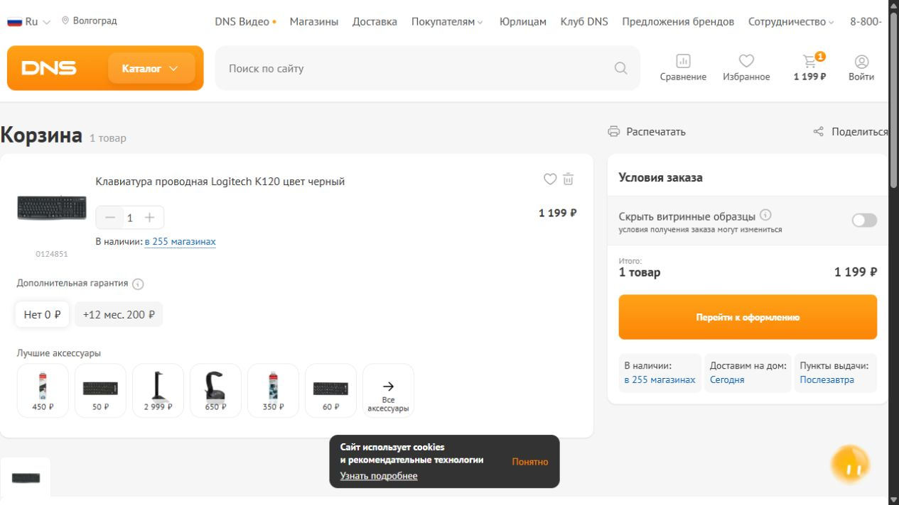

# Практическая работа №3

**Тема:** Smoke-тестирование веб-приложения. Составление баг-репортов.

**Дисциплина:** технологии тестирования программных продуктов.

## 1. Цель работы

Научиться оформлять дефекты в виде воспроизводимых баг-репортов: указывать начальное состояние, последовательность действий, фактический и ожидаемый результаты, окружение, серьезность и приоритет с обоснованием.

## 2. Общая информация и происхождение дефектов

| Параметр | Значение |
| --- | --- |
| Сайт | Российский интернет-магазин DNS |
| Адрес | <https://www.dns-shop.ru/> |
| Дата | 04.11.2026 |
| Формат работы | Индивидуальный отчет |
| Проверяемые разделы | Главная страница, поиск, карточка товара, корзина |
| Тестовый товар | Клавиатура проводная Logitech K120, цвет черный, код `0124851` |
| Карточка товара | <https://www.dns-shop.ru/product/328e0257c6a0526f/klaviatura-provodnaa-logitech-k120-cvet-cernyj/> |
| Окружение | Windows 25H2; браузер с идентификатором `Chrome/156.0.0.0` в User-Agent; точный номер патча браузером не раскрыт |
| Область страницы на снимке | 1265 × 712 px; это размер области страницы, а не разрешение монитора |

Для третьей практической выбран DNS. Первые две работы относятся к другому приложению; их результаты не считаются результатами проверки DNS.

Выполнен короткий smoke-прогон: открытие главной страницы, поиск по запросу `клавиатура`, переход к Logitech K120, добавление одной единицы в корзину, увеличение количества до двух и возврат к одной единице. Цена товара в проверенной сессии составляла 1 199 ₽; для двух единиц сумма стала 2 398 ₽. Первоначальное отсутствие блока покупки оказалось промежуточным состоянием загрузки и в дефекты не включено.

**Происхождение трех отчетов:** BUG-001 обнаружен дополнительно при проверке доступности корзины; BUG-002 и BUG-003 — намеренно смоделированные учебные ситуации. Для них описаны предполагаемые проявления ошибки, а не фактически найденные сбои DNS. Задание допускает смоделированные проблемы; они явно отделены от наблюдаемых результатов. Преподавателю можно представить их как учебные примеры, требующие согласования такого формата.

| ID | Происхождение | Компонент | Severity | Priority |
| --- | --- | --- | --- | --- |
| BUG-001 | Обнаружен при дополнительной проверке | Корзина: доступность кнопок количества | Major | Medium |
| BUG-002 | Учебная модель; на сайте не подтвержден | Поиск | Major | High |
| BUG-003 | Учебная модель; на сайте не подтвержден | Корзина: пересчет суммы | Critical | High |

Серьезность и приоритет являются оценками для учебного отчета, а не решениями команды DNS. Внешние обращения и сообщения в службу поддержки не создавались.

## 3. Баг-репорты

### BUG-001. Кнопки уменьшения и увеличения количества товара в корзине не имеют доступных названий

| Поле | Значение |
| --- | --- |
| ID | BUG-001 |
| Краткое описание (Summary) | Кнопки «−» и «+» у товара в корзине представлены в дереве доступности без названий |
| Компонент / раздел | Корзина → счетчик количества товара |
| Происхождение | Обнаружен дополнительно при инспекции доступности после smoke-прогона |
| Серьезность (Severity) | Major |
| Обоснование серьезности | Важное действие изменения количества нельзя однозначно определить по программному названию кнопки. Обходной путь — редактирование числового поля или визуальное управление; изменение количества мышью доступно |
| Приоритет (Priority) | Medium |
| Обоснование приоритета | Проблема затрагивает доступность основного сценария корзины, но покупка с визуальным управлением остается доступной. При обязательных требованиях к доступности приоритет следует повысить |
| Окружение | Windows 25H2; `Chrome/156.0.0.0` по User-Agent, точный патч не раскрыт; область страницы 1265 × 712 px; пользователь не авторизован |
| Предусловия | DNS доступен, корзина пустая либо содержит только тестовую клавиатуру; на странице нет перекрывающих диалогов. В наблюдаемой корзине в шапке указан регион «Волгоград» |
| Тестовые данные | Logitech K120, код `0124851`; количество 1; URL карточки приведен в общей информации |
| Фактический результат | В дереве доступности счетчик представлен как `button`, `spinbutton: 1`, `button`. Обе кнопки имеют пустой текст, а атрибуты `aria-label`, `aria-labelledby` и `title` отсутствуют; назначение «уменьшить» или «увеличить» программным названием не передается |
| Ожидаемый результат | Каждая кнопка имеет различимое программно определяемое название, например «Уменьшить количество Logitech K120» и «Увеличить количество Logitech K120» |
| Основание ожидания | Критерий доступности интерфейса: назначение интерактивного элемента должно определяться без необходимости видеть графическую иконку |
| Воспроизводимость | Зафиксировано для обеих кнопок одного товара; названия отсутствовали при количестве 1 и 2. Проверка отдельным экранным диктором не проводилась |
| Вложения | [Снимок корзины](evidence/bug-001.png), [фрагменты разметки и результаты инспекции](evidence/bug-001-accessibility.json) |
| Статус | Зафиксирован в отчете; требуется проверка разработчиком |

**Шаги воспроизведения:**

1. Открыть DNS без авторизации и установить выбранный тестовый регион; для точного повторения наблюдаемого окружения — Волгоград.
2. Убедиться, что корзина пуста. Открыть карточку Logitech K120 по ссылке из общей информации.
3. Дождаться загрузки блока покупки и нажать «Купить» один раз.
4. Перейти в корзину по значку в шапке сайта и дождаться появления товара.
5. Открыть инструменты разработчика браузера и инспектор доступности элемента.
6. Проверить кнопку с иконкой «−» слева от числового поля количества, затем кнопку «+» справа от него.
7. Сравнить роль и доступное название обеих кнопок; проверить текст элемента и атрибуты, задающие название.

Сохраненные фрагменты разметки:

```html
<button class="count-buttons__button count-buttons__button_minus"><i class="count-buttons__icon count-buttons__icon-minus"></i></button>
<button class="count-buttons__button count-buttons__button_plus"><i class="count-buttons__icon count-buttons__icon-plus"></i></button>
```

Снимок показывает расположение счетчика, а отсутствие доступных названий подтверждается инспекцией и JSON-вложением. Оба элемента включены в один баг-репорт как проявления одной проблемы оформления счетчика.



### BUG-002. Поиск по запросу «клавиатура» возвращает пустую выдачу при наличии Logitech K120 в каталоге — учебная модель

| Поле | Значение |
| --- | --- |
| ID | BUG-002 |
| Краткое описание (Summary) | Поиск DNS по запросу «клавиатура» возвращает пустую выдачу при доступной карточке Logitech K120 |
| Компонент / раздел | Поиск товаров |
| Происхождение | Намеренно смоделированная учебная ситуация; на реальном сайте не подтверждена |
| Серьезность (Severity) | Major |
| Обоснование серьезности | Важная функция поиска работает неверно для обычного товарного запроса; обходной путь — каталог или прямая ссылка на карточку |
| Приоритет (Priority) | High |
| Обоснование приоритета | Поиск — один из основных путей выбора товара; пустая выдача по распространенному запросу мешает началу покупки |
| Окружение | Целевое окружение модели: Windows 25H2; `Chrome/156.0.0.0` по User-Agent; пользователь не авторизован; регион Москва |
| Предусловия | Главная страница доступна; поиск пуст; карточка Logitech K120 открывается напрямую и товар относится к клавиатурам. В учебной ситуации предполагается сбой поиска; сайт не изменялся и ошибка технически не внедрялась |
| Тестовые данные | Точный запрос `клавиатура`, без кавычек и дополнительных пробелов; контрольный товар — Logitech K120, код `0124851` |
| Фактический результат | Смоделированное проявление: после завершения поиска показано «Найдено 0 товаров»; карточки товаров в выдаче отсутствуют, хотя контрольная карточка открывается напрямую |
| Ожидаемый результат | Отображается непустая выдача товаров категории клавиатур; запрос не должен считаться не давшим результатов при наличии соответствующих товаров |
| Основание ожидания | Назначение товарного поиска и наличие подходящего контрольного товара в каталоге |
| Вложения | —; подтверждающего снимка нет, поскольку ошибка смоделирована |
| Статус | Учебная модель; воспроизводимость на реальном DNS не заявляется |

**Шаги воспроизведения учебной ситуации:**

1. Открыть <https://www.dns-shop.ru/> без авторизации.
2. Выбрать город Москва и закрыть диалоги, перекрывающие поиск.
3. Открыть карточку контрольного товара по ссылке из общей информации и убедиться, что она доступна.
4. Вернуться на главную страницу.
5. Ввести в поле «Поиск по сайту» точный запрос `клавиатура` и нажать Enter.
6. Дождаться завершения загрузки выдачи; проверить число найденных товаров и наличие товарных карточек.

**Контрольное наблюдение:** в выполненной проверке запрос `клавиатура` вернул непустую выдачу, из которой удалось открыть Logitech K120. Пустая выдача в этом баг-репорте — условие модели, а не результат фактического прогона.

### BUG-003. Итог корзины не изменяется после увеличения количества Logitech K120 с одной до двух единиц — учебная модель

| Поле | Значение |
| --- | --- |
| ID | BUG-003 |
| Краткое описание (Summary) | Итог корзины остается 1 199 ₽ после увеличения количества Logitech K120 до двух единиц по цене 1 199 ₽ за штуку |
| Компонент / раздел | Корзина → изменение количества и расчет итоговой стоимости |
| Происхождение | Намеренно смоделированная учебная ситуация; на реальном сайте не подтверждена |
| Серьезность (Severity) | Critical |
| Обоснование серьезности | В модели нарушен основной расчет стоимости корзины: пользователь получает неверный итог заказа. Речь идет о показанной сумме; фактическое неверное списание денег не предполагается и не проверялось |
| Приоритет (Priority) | High |
| Обоснование приоритета | Корректность суммы непосредственно влияет на доверие к покупке и переход к оформлению |
| Окружение | Целевое окружение модели: Windows 25H2; `Chrome/156.0.0.0` по User-Agent; область страницы 1265 × 712 px; пользователь не авторизован |
| Предусловия | Корзина содержит только одну Logitech K120 по цене 1 199 ₽; нет дополнительных услуг и других товаров; гарантия «Нет 0 ₽»; доступно увеличение количества до двух. Предполагается ошибка пересчета, которая технически не внедрялась |
| Тестовые данные | Код товара `0124851`; количество `1 → 2`; цена 1 199 ₽ за штуку; контрольная сумма `1 199 × 2 = 2 398 ₽` |
| Фактический результат | Смоделированное проявление: поле количества показывает 2, а блок «Итого» после завершения обновления продолжает показывать 1 199 ₽ |
| Ожидаемый результат | При количестве 2 и неизменной цене 1 199 ₽ за штуку итог стоимости товаров равен 2 398 ₽; значение в шапке корзины согласовано с итогом |
| Основание ожидания | Стоимость товаров без дополнительных услуг равна сумме произведений цены единицы на количество |
| Вложения | —; подтверждающего снимка нет, поскольку ошибка смоделирована |
| Статус | Учебная модель; воспроизводимость на реальном DNS не заявляется |

**Шаги воспроизведения учебной ситуации:**

1. Открыть DNS без авторизации; выбрать один тестовый регион и сохранить его для всего сценария.
2. Убедиться, что корзина пуста; открыть карточку Logitech K120 по ссылке из общей информации.
3. Проверить, что цена равна 1 199 ₽ и доступна покупка двух единиц. Если цена изменилась, записать новую цену `P` и использовать ожидаемый итог `2 × P` вместо чисел примера.
4. Добавить товар в корзину один раз и открыть корзину.
5. Убедиться, что количество равно 1, дополнительные услуги не выбраны и итог равен цене одной единицы.
6. Нажать «+» у количества один раз, чтобы получить 2.
7. Дождаться завершения обновления и сравнить количество, цену единицы и блок «Итого».

**Контрольное наблюдение:** при фактической проверке увеличение количества до двух привело к сумме 2 398 ₽. Ошибочный итог 1 199 ₽ в этом баг-репорте — условие учебной модели. Промежуточное состояние во время загрузки не считается таким дефектом.

## 4. Выводы

Оформлены три баг-репорта для DNS: один наблюдаемый дефект доступности и две учебные модели функциональных ошибок. Для каждого приведены начальное состояние, конкретные данные, шаги, ожидаемый и фактический либо смоделированный результат, окружение, серьезность и приоритет с обоснованием. Для наблюдаемого дефекта сохранены снимок экрана и фрагменты разметки.

Качественный баг-репорт позволяет воспроизвести конкретное несоответствие без догадок. В отличие от краткого пункта чеклиста он содержит точные данные, начальное состояние, действия и результаты. Серьезность показывает влияние на функции приложения, а приоритет — очередность исправления; эти оценки необходимо обосновывать отдельно.

## 5. Ответы на контрольные вопросы

1. **Чем баг-репорт отличается от записи в чеклисте со статусом Fail?** Fail сообщает, что проверка не пройдена. Баг-репорт описывает конкретный дефект: где он возникает, в каком окружении, с какими данными и шагами, что получилось и что ожидалось, насколько велико влияние и насколько срочно нужно исправление. Одна причина может приводить к нескольким Fail, поэтому число упавших проверок не обязательно равно числу дефектов.
2. **В чем разница между серьезностью и приоритетом? Приведите свой пример.** Серьезность (Severity) характеризует влияние ошибки на систему и пользователя, приоритет (Priority) — срочность ее исправления. Например, опечатка в названии акции может иметь Trivial по серьезности, но High по приоритету перед рекламным запуском. Несогласованная сумма корзины в учебной модели BUG-003 имеет Critical / High, поскольку нарушает основной расчет стоимости.
3. **Почему нельзя писать в Summary просто «не работает»?** Такая фраза не определяет элемент, место, условие и наблюдаемое отклонение. Заголовок «Итог корзины не изменяется после увеличения количества товара с одной до двух единиц» позволяет понять проблему и найти похожие сообщения до чтения всех шагов.
4. **Какие поля критичны разработчику для воспроизведения дефекта?** Адрес и компонент, точное окружение с версией браузера, начальное состояние и предусловия, входные данные, нумерованные шаги, фактический и ожидаемый результаты. Скриншоты, видео и логи уточняют наблюдение; ID помогает ссылаться на дефект, а серьезность и приоритет — определить очередность работы.
5. **Когда дефект можно считать Blocker, а когда только Critical?** Blocker полностью препятствует использованию продукта или продолжению зависимых проверок: например, сайт не открывается для всех пользователей в поддерживаемом окружении. Critical разрушает основной сценарий, хотя другие части продукта доступны: например, в магазине неверно рассчитывается итог заказа, но каталог и поиск работают. Оценка зависит от масштаба, обязательных сценариев и наличия обходного пути; отдельный дефект доступности счетчика сам по себе не делает весь сайт Blocker.

## 6. Материалы

- Задание: предоставленный файл «Практическая_работа_3_Баг-репорты.pdf».
- Сайт: <https://www.dns-shop.ru/>.
- Контрольный товар: [Logitech K120, код 0124851](https://www.dns-shop.ru/product/328e0257c6a0526f/klaviatura-provodnaa-logitech-k120-cvet-cernyj/).
- [Доказательства наблюдаемого дефекта доступности](evidence/bug-001-accessibility.json).
