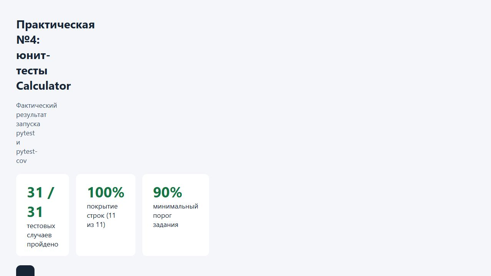

# Практическая работа №4

**Тема:** юнит-тестирование на Python. Основы pytest.

**Дисциплина:** технологии тестирования программных продуктов.

## 1. Цель работы

Реализовать класс `Calculator`, разработать независимые юнит-тесты на pytest с параметризацией, проверками исключений и приближенным сравнением дробных чисел. Получить покрытие строк не ниже 90% и сохранить результаты запуска.

## 2. Общая информация

| Параметр | Значение |
| --- | --- |
| Объект | Класс `Calculator` |
| Язык | Python 3.12.14 |
| Окружение | Windows, отдельное виртуальное окружение Python |
| Инструменты | pytest 9.2.0, pytest-cov 7.1.0, coverage 7.17.1 |
| Тип тестирования | Автоматическое юнит-тестирование |
| Результат | 31 тестовый случай пройден; покрытие строк `calculator.py` — 100% |

Работа выполняется на уровне кода и не обращается к DNS или другим веб-приложениям. Сетевые сервисы, базы данных и внешние зависимости для вычислений не используются.

## 3. Реализация Calculator

Исходный код: [calculator.py](calculator.py).

| Метод | Назначение | Особенность |
| --- | --- | --- |
| `add(a, b)` | Сложение | Возвращает `a + b` |
| `subtract(a, b)` | Вычитание | Возвращает `a - b` |
| `multiply(a, b)` | Умножение | Возвращает `a * b` |
| `divide(a, b)` | Деление | Возвращает `a / b`; при `b == 0` выбрасывает `ValueError` |

Допустимые входные данные по заданию — `int` и `float`, в том числе их сочетания. Класс не хранит изменяемое состояние. Результат деления является `float`, а сложение, вычитание и умножение целых чисел сохраняют целочисленную точность. Нулевые знаменатели `0`, `0.0` и `-0.0` обрабатываются одной проверкой `b == 0`.

Пример использования:

```python
from calculator import Calculator

calc = Calculator()
print(calc.add(2, 3))        # 5
print(calc.subtract(8, 3))   # 5
print(calc.multiply(4, 3))   # 12
print(calc.divide(10, 2))    # 5.0
```

Передача строк, `None` и других типов, а также специальные значения `NaN` и бесконечность не входят в заданный контракт. Дополнительная валидация таких аргументов не вводилась.

## 4. Разработка тестов

Набор тестов: [test_calculator.py](test_calculator.py).

| Группа тестов | Количество случаев | Основные проверки |
| --- | --- | --- |
| `test_add_integers` | 5 | Положительные числа, противоположные знаки, два нуля, отрицательное второе слагаемое, большие целые |
| `test_add_floats` | 2 | `0.1 + 0.2 ≈ 0.3`, сложение дробных чисел разных знаков |
| `test_subtract_integers` | 5 | Положительные числа, два нуля, нулевое уменьшаемое, два отрицательных числа, большие целые |
| `test_subtract_floats` | 2 | `0.3 - 0.1 ≈ 0.2`, смешанные аргументы `int` и `float` |
| `test_multiply_integers` | 5 | Положительные числа, нулевой множитель, разные знаки, два отрицательных множителя, большие целые |
| `test_multiply_floats` | 2 | Дробные числа, смешанные аргументы `int` и `float` |
| `test_divide` | 6 | Положительные числа, нулевой числитель, разные знаки, два отрицательных числа, дробный результат, большие числа |
| `test_divide_by_zero` | 4 | Ненулевой и нулевой числитель, знаменатели `0`, `0.0` и `-0.0` |
| **Всего** | **31** | **8 тестовых функций с параметризацией** |

### Структура AAA

В каждом тесте выделяются подготовка объекта, вызов метода и проверка результата:

```python
def test_add_integers(a, b, expected):
    calc = Calculator()          # Arrange
    result = calc.add(a, b)       # Act
    assert result == expected    # Assert
```

Входные значения поступают из декоратора `@pytest.mark.parametrize`. Для целочисленного сложения задано пять наборов данных, что превышает требуемый минимум из четырех. Все остальные группы также параметризованы.

### Проверки float

Из-за двоичного представления дробных чисел сравнение выполняется через `pytest.approx`:

```python
assert result == pytest.approx(expected)
```

Например, для деления `1 / 3` ожидается результат, приблизительно равный `0.3333333333333333`. Используется стандартный допуск `pytest.approx`; целочисленные операции проверяются точным равенством, включая значения порядка `10**30` и `10**60`.

### Проверки исключений

```python
def test_divide_by_zero(a, b):
    calc = Calculator()
    with pytest.raises(ValueError):
        calc.divide(a, b)
```

Проверяется обязательный тип исключения. Тест не привязан к тексту сообщения, поскольку задание не задает его как часть контракта.

### Независимость

Каждый тестовый случай создает собственный экземпляр `Calculator`. Общего изменяемого состояния, файлов с промежуточными результатами и зависимости от порядка запуска нет. Ожидаемые значения заданы в тестовых данных и не вычисляются вызовом другого метода калькулятора.

## 5. Запуск и фактические результаты

Зависимости зафиксированы в [requirements.txt](requirements.txt).

Пример подготовки окружения в PowerShell из папки `practice-04` с установленными Python и `uv`:

```powershell
python -m venv --without-pip .venv
uv pip install --python .venv/Scripts/python.exe -r requirements.txt
```

Команда запуска тестов с контролем минимального покрытия:

```powershell
.venv/Scripts/python.exe -m pytest test_calculator.py -v --cov=calculator --cov-report=term-missing --cov-fail-under=90
```

Для повторного сохранения машинного отчета можно добавить `--cov-report=json:evidence/coverage.json`. В сохраненном выводе дополнительно использованы `--no-header` и `--color=no`, чтобы убрать служебный заголовок и цветовые коды; набор проверок от этого не меняется.

Фактический результат:

```text
Name            Stmts   Miss  Cover   Missing
---------------------------------------------
calculator.py      11      0   100%
---------------------------------------------
TOTAL              11      0   100%

Required test coverage of 90% reached. Total coverage: 100.00%
31 passed in 0.12s
```

Полный вывод: [pytest-output.txt](evidence/pytest-output.txt). Машинный отчет: [coverage.json](evidence/coverage.json).

Покрытие рассчитано для модуля `calculator`, содержащего только класс `Calculator`. Выполнены все 11 учитываемых строк; пропущенных строк нет. Тесты вызывают как обычное деление, так и ветвь исключения, однако отдельная метрика покрытия ветвей в этом запуске не измерялась. Значение 100% относится к строкам, а не к полноте всех возможных входных данных.

### Скриншот результатов

На скриншоте показана локальная HTML-страница, сформированная из сохраненного фактического вывода pytest. Это снимок страницы отчета, а не терминала. Страница содержит полный вывод в раскрываемом блоке и доступна как [results.html](evidence/results.html).



## 6. Проверка выполнения задания

| Требование | Выполнение |
| --- | --- |
| Реализованы четыре операции | Методы `add`, `subtract`, `multiply`, `divide` в `Calculator` |
| Позитивные сценарии для каждого метода | Покрыты четырьмя группами арифметических проверок |
| Нули, отрицательные и большие числа | Включены в параметризованные наборы |
| Деление на ноль через `pytest.raises` | Четыре случая с ожидаемым `ValueError` |
| Не менее четырех наборов для `add` или `subtract` | По пять целочисленных наборов для каждого метода |
| Проверка деления с float и `pytest.approx` | Шесть случаев деления; дробный результат `1 / 3` |
| Не менее десяти тестовых случаев | 31 случай, все пройдены |
| Покрытие строк не ниже 90% | 100%, порог проверяется параметром `--cov-fail-under=90` |
| Тесты независимы | Новый объект в каждом случае, общего изменяемого состояния нет |
| Код, отчет, скриншот и ответы на вопросы | Добавлены в папку практической |

## 7. Выводы

Реализован класс `Calculator` и подготовлен набор из 31 независимого тестового случая. Применены структура AAA, параметризация, точное сравнение целых чисел, приближенное сравнение дробных результатов и проверка исключений.

Все тесты прошли; покрытие строк составило 100% при требуемых 90%. Покрытие подтверждает выполнение кода, но не заменяет анализ входных данных: поэтому отдельно включены нули, отрицательные и большие числа, дробные результаты и ошибки деления.

## 8. Ответы на контрольные вопросы

1. **Чем юнит-тест отличается от smoke-проверки?** Юнит-тест проверяет небольшую единицу кода в изоляции: например, результат `Calculator.add(2, 3)`. Smoke-проверка оценивает минимальную работоспособность важных функций приложения в целом: например, открытие сайта, поиск товара и доступность корзины. Smoke описывает цель и глубину отбора проверок, а unit — уровень изоляции тестируемого кода.
2. **Что означает структура AAA?** Arrange — подготовить данные и объект; Act — выполнить проверяемое действие; Assert — сравнить результат с ожидаемым или проверить исключение. Такая структура помогает понять причину падения и отделить подготовку от самого действия.
3. **Зачем нужна параметризация тестов?** Она запускает одну тестовую функцию на нескольких наборах входных данных и ожиданий без дублирования ее тела. Каждый набор является отдельным тестовым случаем и получает собственный результат; в этой работе восемь функций дают 31 случай.
4. **Что показывает coverage и почему 100% не всегда нужно?** Покрытие строк показывает долю учитываемых строк, выполненных во время тестов; покрытие ветвей — долю выполненных переходов логики. Даже 100% строк не гарантируют правильность всех результатов и полноту требований. Дополнительные тесты следует выбирать по рискам и значимым сценариям, а не только ради процента; для небольшого калькулятора все строки естественно покрываются обязательными проверками.
5. **Почему тесты должны быть независимыми друг от друга?** Чтобы результат не зависел от порядка выполнения, предыдущих запусков и оставшихся данных. Независимый тест можно запустить отдельно, повторить после исправления и при подходящей организации выполнять параллельно; падение одного теста не должно изменять условия другого.

## 9. Материалы

- Задание: предоставленный файл «Практическая_работа_4_Юнит-тесты_pytest.pdf».
- [Реализация Calculator](calculator.py) и [набор тестов](test_calculator.py).
- [Полный вывод запуска](evidence/pytest-output.txt), [данные покрытия](evidence/coverage.json) и [HTML-представление результатов](evidence/results.html).
