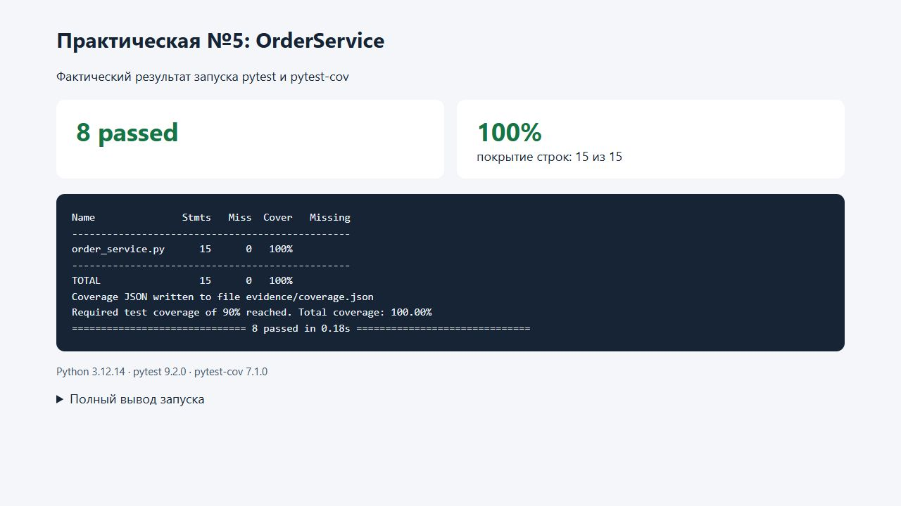

# Практическая работа №5

**Тема:** юнит-тестирование с зависимостями. Моки и параметризация.

## 1. Цель работы

Реализовать сервис оформления заказов с внедряемыми зависимостями и проверить его поведение в изоляции: успешное сохранение, отказ, исключение хранилища и получение заказа. Применить моки, проверки взаимодействий и параметризацию.

## 2. Реализация

Код: [order_service.py](order_service.py). Тесты: [test_order_service.py](test_order_service.py).

`OrderService(storage, notifier)` принимает хранилище и отправитель уведомлений через конструктор. Интерфейсы описаны протоколами `Storage` и `Notifier`, а конкретные подключения к БД или почте сервису не нужны.

| Сценарий | Поведение |
| --- | --- |
| `storage.save_order(order_id, data)` возвращает `True` | Отправить `notifier.send(order_id, data)` и вернуть `True` |
| Хранилище возвращает `False` | Вернуть `False`, не отправляя уведомление |
| Хранилище выбрасывает исключение | Пробросить тот же объект исключения; уведомление не отправлять |
| `get_order(order_id)` | Вернуть результат `storage.get_order(order_id)` без преобразования, в том числе `None` |

Отправка уведомления расположена после успешного возврата из сохранения. Благодаря этому при исключении уведомление также не выполняется. Повторные попытки и компенсация ошибок отправителя не предусмотрены заданием.

## 3. Подмена зависимостей и тесты

Обе зависимости заменены `unittest.mock.create_autospec` с `instance=True` и `spec_set=True`. Моки проверяют интерфейс: несуществующий метод нельзя вызвать или присвоить ему значение; сигнатуры методов также контролируются. Для каждого случая фикстуры создают новые моки и новый сервис.

| Проверка | Число случаев | Проверяемые взаимодействия |
| --- | --- | --- |
| Успешное оформление | 3 | Сохранение и отправка вызваны ровно один раз с теми же ID и данными |
| Отказ сохранения | 1 | Сохранение вызвано один раз, `notifier.send.assert_not_called()` |
| Исключение сохранения | 1 | Наружу передан исходный `RuntimeError`, уведомление не вызвано |
| Получение существующего заказа | 1 | `get_order` вызван с нужным ID; данные возвращены без замены объекта |
| Получение отсутствующего заказа | 1 | Возвращен `None`; сохранение и отправка не вызваны |
| Ошибка чтения хранилища | 1 | Ошибка проброшена, уведомление не вызвано |
| **Итого** | **8** | **6 тестовых функций** |

Параметризованный успешный сценарий содержит три заказа: книга за 500, ручка за 50 и ноутбук за 80 000. Использованы читаемые идентификаторы `book`, `pen`, `laptop`.

Пример проверки взаимодействий:

```python
storage.save_order.return_value = True
result = service.place_order(order_id, data)
assert result is True
storage.save_order.assert_called_once_with(order_id, data)
notifier.send.assert_called_once_with(order_id, data)
```

В негативном сценарии `storage.save_order.side_effect` задает исключение. Проверка `caught.value is error` подтверждает, что ошибка не скрыта и не заменена другим исключением. Это защищает от ложного подтверждения заказа, который не был сохранен.

## 4. Запуск и результаты

Окружение фактического запуска: Windows, Python 3.12.14, pytest 9.2.0, pytest-cov 7.1.0, coverage 7.17.1. Зависимости: [requirements.txt](requirements.txt).

Из папки `practice-05`:

```powershell
python -m venv --without-pip .venv
uv pip install --python .venv/Scripts/python.exe -r requirements.txt
.venv/Scripts/python.exe -m pytest test_order_service.py -v --cov=order_service --cov-report=term-missing --cov-fail-under=90
```

Фактический итог — **8 passed**, покрытие `order_service.py` — **100%**, выполнены 15 из 15 учитываемых строк. Требования этой работы не задают порог покрытия; 90% используется как дополнительный локальный контроль.

Сохранены [полный вывод запуска](evidence/pytest-output.txt) и [машинный отчет покрытия](evidence/coverage.json). Проверки не используют настоящую БД, сеть и отправку сообщений. Покрытие строк не является доказательством полноты всех возможных сценариев.

Скриншот показывает [HTML-представление фактического вывода](evidence/results.html), а не терминал:



## 5. Выводы

Сервис отделен от инфраструктуры за счет внедрения зависимостей. Тесты проверяют не только возвращаемые значения, но и правильные аргументы, число вызовов и отсутствие уведомлений при неуспешном сохранении. Параметризация расширяет набор данных без дублирования тестовой логики.

## 6. Ответы на контрольные вопросы

1. **Зачем подменять зависимости моками, а не использовать реальную базу?** Чтобы проверять логику сервиса независимо от доступности, состояния и скорости БД, воспроизводить ошибки и точно контролировать взаимодействия. Реальная БД проверяется отдельными интеграционными тестами.
2. **Чем заглушка отличается от мока?** Заглушка возвращает подготовленный ответ. Мок дополнительно записывает обращения, позволяя проверить аргументы, количество вызовов и отсутствие вызова. Один объект `Mock` может выполнять обе роли.
3. **Зачем проверять, что notifier не вызывался при ошибке сохранения?** Возвращаемый `False` сам по себе не гарантирует отсутствие побочных действий. Ошибочное уведомление могло бы сообщить пользователю о заказе, которого в хранилище нет.
4. **Что делает side_effect у Mock?** Позволяет выбрасывать заданное исключение, выполнять функцию вместо метода или выдавать последовательность результатов. В этой работе `side_effect` воспроизводит отказ хранилища при записи и чтении.
5. **Почему юнит-тест не должен ходить в сеть или открывать реальные файлы?** Для изолированной логики сервиса это внешние зависимости, которые добавляют задержки, непредсказуемость и побочные эффекты. Их заменяют контролируемыми объектами; работу самой инфраструктуры проверяют отдельно. Для функций, чье назначение — файловый ввод-вывод, допустимы отдельные проверки с временными файлами и явной очисткой.

## 7. Материалы

- Задание: «Практическая_работа_5_Моки_и_параметризация.pdf».
- [Сервис](order_service.py), [тесты](test_order_service.py), [результаты](evidence/pytest-output.txt).
