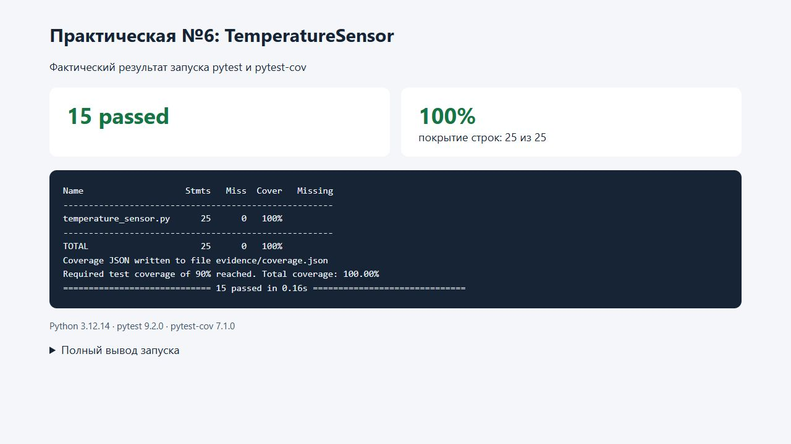

# Практическая работа №6

**Тема:** тестирование событийной модели и pytest fixtures.

## 1. Цель работы

Реализовать событийную модель датчика температуры, подготовить фикстуры pytest и проверить уведомления, подписку, отписку и изоляцию ошибок подписчиков.

## 2. Реализация и принятые правила

Код: [temperature_sensor.py](temperature_sensor.py). Тесты: [test_temperature_sensor.py](test_temperature_sensor.py).

| Элемент | Поведение |
| --- | --- |
| `TemperatureSensor()` | Начальное значение `0.0`; список подписчиков пуст |
| `temperature` | Свойство для чтения текущего значения |
| `subscribe(callback)` | Добавляет подписчика; повторная подписка того же колбэка не дублируется |
| `unsubscribe(callback)` | Удаляет конкретного подписчика; чужой колбэк и повторная отписка безопасны |
| `set_temperature(value)` | При реальном изменении сохраняет значение и вызывает подписчиков с новым значением |
| Установка того же значения | Нет уведомления |
| Ошибка подписчика | Записывается в журнал; остальные подписчики продолжают получать событие |

В момент рассылки создается снимок списка подписчиков через `tuple`. Изменение подписок во время колбэка действует на следующее событие и не нарушает текущий обход. Это явно выбранное поведение; тест с отпиской во время события подтверждает его.

Перехватываются обычные исключения `Exception`, а не системные прерывания. Ошибка не теряется: `logger.exception` сохраняет сообщение и traceback. Возврат из `set_temperature` не используется как результат события — наблюдаются вызовы колбэков и состояние сенсора.

## 3. Фикстуры и тестовые случаи

Фикстура `sensor` создает новый датчик с `0.0`. Фикстура `ready_sensor` на его основе устанавливает 20 до подписки наблюдателей. Обе имеют стандартную область `function`, поэтому каждый тест получает отдельный объект и историю событий. Все тесты используют одну из этих фикстур.

| Проверка | Число случаев | Что подтверждается |
| --- | --- | --- |
| Начальное значение | 1 | `temperature == 0.0` |
| Изменение температуры | 1 | Одно событие с аргументом 21 и обновленное состояние |
| Повторная установка 20 | 1 | Колбэк не вызывается |
| Несколько подписчиков | 1 | Три колбэка получают одно и то же значение |
| Отписка конкретного колбэка | 1 | Удаленный не вызывается; оставшийся получает событие |
| Параметризованное изменение | 4 | Значения −15, 0, 20.5 и 1000 доставляются корректно |
| Чужой колбэк при отписке | 1 | Ошибки нет; действующий подписчик продолжает работать |
| Повторная отписка | 1 | Ошибки и уведомления удаленного подписчика нет |
| Исключение среднего подписчика | 1 | Первый и последний тоже вызваны; ошибка есть в журнале |
| Повторная подписка | 1 | Событие не дублируется |
| Последовательность 21, 21, 22 | 1 | История содержит только события 21 и 22 в этом порядке |
| Отписка во время рассылки | 1 | Текущее событие доставлено по снимку, следующее не приходит удаленному колбэку |
| **Всего** | **15** | **12 тестовых функций** |

Для наблюдения за событиями используются `Mock`, `assert_called_once_with`, `assert_not_called` и `call_args_list`. Проверка ошибки подписчика использует `caplog`: она подтверждает не только продолжение рассылки, но и сохранение диагностического сообщения.

## 4. Запуск и результаты

Окружение: Windows, Python 3.12.14, pytest 9.2.0, pytest-cov 7.1.0, coverage 7.17.1. Зависимости: [requirements.txt](requirements.txt).

Из папки `practice-06`:

```powershell
python -m venv --without-pip .venv
uv pip install --python .venv/Scripts/python.exe -r requirements.txt
.venv/Scripts/python.exe -m pytest test_temperature_sensor.py -v --cov=temperature_sensor --cov-report=term-missing --cov-fail-under=90
```

Фактический итог — **15 passed**, покрытие `temperature_sensor.py` — **100%**: выполнены все 25 учитываемых строк. Порог 90% добавлен для локального контроля; в задании №6 отдельный порог не установлен.

Подтверждение: [полный вывод](evidence/pytest-output.txt), [данные покрытия](evidence/coverage.json). Дополнительные требования для полного балла выполнены: есть два негативных сценария отписки и проверка продолжения рассылки после исключения колбэка.

Скриншот показывает [HTML-представление фактического вывода](evidence/results.html), а не терминал:



## 5. Выводы

События возникают только при фактическом изменении значения и содержат новую температуру. Отписка безопасна, подписчики независимы, ошибка одного обработчика не прекращает доставку остальным. Фикстуры обеспечивают одинаковую подготовку без переноса состояния между тестами.

## 6. Ответы на контрольные вопросы

1. **Чем проверка события отличается от проверки возвращаемого значения метода?** Событие — взаимодействие с подписчиком. Проверяются факт и количество вызовов, аргументы и порядок, а не только значение, возвращенное вызывающему коду.
2. **Зачем не уведомлять подписчиков, если значение не изменилось?** Чтобы исключить лишние пересчеты и повторные реакции, уменьшить нагрузку и риск циклических обновлений. Уведомление должно означать реальное изменение состояния.
3. **Что дает fixture по сравнению с созданием объекта в каждом тесте?** Централизует подготовку, позволяет явно выразить зависимости и обеспечить одинаковое исходное состояние. Область `function` дает изоляцию, а `yield` при необходимости позволяет добавить очистку после теста.
4. **Как убедиться, что колбэк вызван с конкретным аргументом?** Подписать мок и после изменения выполнить `callback.assert_called_once_with(21)`. Для последовательности событий проверить `call_args_list`, для отсутствия — `assert_not_called()`.
5. **Что было аналогом QSignalSpy?** Мок-колбэк из `unittest.mock`: он записывает события как вызовы, их количество и переданные аргументы. В отличие от Qt, здесь уведомления синхронные и цикл обработки сигналов не нужен.

## 7. Материалы

- Задание: «Практическая_работа_6_События_и_fixtures.pdf».
- [Датчик](temperature_sensor.py), [тесты](test_temperature_sensor.py), [результаты](evidence/pytest-output.txt).
