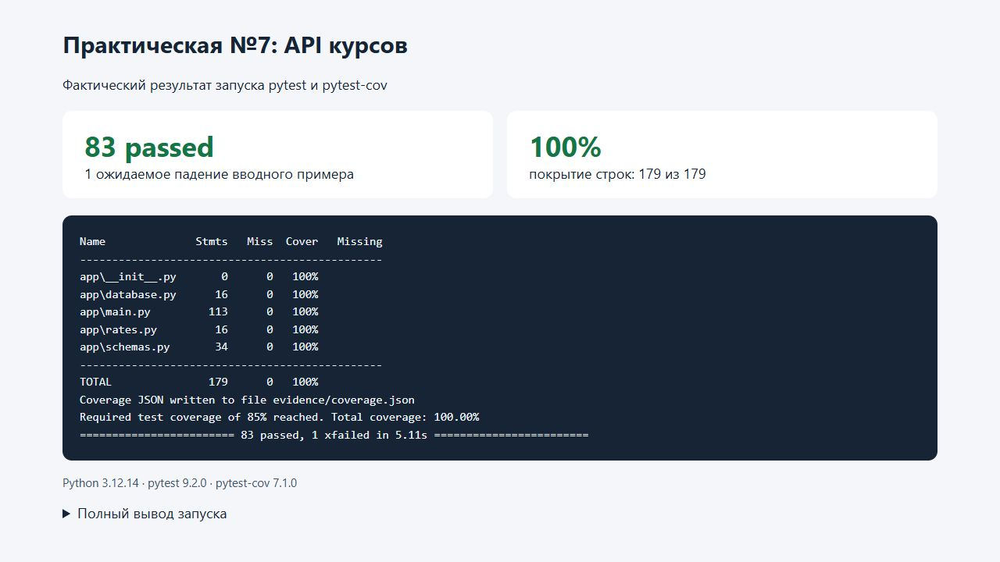

# Практическая работа №7

**Тема:** автотесты HTTP API.

## 1. Цель работы

Разработать REST API учета курсов с базой данных, ролями и внешним сервисом курсов валют. Проверить API через TestClient: позитивные и негативные сценарии, побочные эффекты, изоляцию БД, подмену зависимостей, случайный порядок запуска и чувствительность тестов к двум намеренным ошибкам.

## 2. Вариант и окружение

| Параметр | Значение |
| --- | --- |
| Вариант | 3 — учет курсов |
| Ресурс | `/courses` |
| Счетчик | `slots` — число свободных мест |
| Эндпоинт изменения | `POST /courses/{id}/slots` |
| Значение `delta > 0` | Отчисление: свободных мест становится больше |
| Значение `delta < 0` | Запись: свободных мест становится меньше |
| Допустимый диапазон | От 0 до 30 включительно |
| Окружение | Windows, Python 3.12.14 |
| Библиотеки | FastAPI 0.162.0, Pydantic 2.14.2, SQLAlchemy 2.0.57, httpx 0.28.1, httpx2 2.16.0 |
| Тестирование | pytest 9.2.0, pytest-cov 7.1.0, coverage 7.17.1, pytest-random-order 1.2.0 |

Все методы и поля из примера `/items` адаптированы к выбранному варианту. Фикстура `make_item` сохраняет имя из задания, но создает курс. Тесты запускаются внутри процесса через TestClient; отдельный HTTP-сервер для них не нужен.

## 3. Разминка: поиск ошибки в app_v0

Исходный пример с намеренной ошибкой: [warmup/app_v0.py](warmup/app_v0.py). Дефект состоит в вычислении ID как `len(ITEMS) + 1`: количество элементов не равно максимальному занятому идентификатору.

| Шаг | Запрос | Состояние хранилища |
| --- | --- | --- |
| 1 | `POST /items` с `{"name":"First","price":10}` | Создан ID 1 |
| 2 | `POST /items` с `{"name":"Second","price":20}` | Создан ID 2 |
| 3 | `DELETE /items/1` | Остается ID 2; длина словаря равна 1 |
| 4 | `POST /items` с `{"name":"Third","price":30}` | Ошибочно снова выбран ID 2, данные Second перезаписаны |

[Тест](warmup/test_id_collision.py) проверяет, что третий ID отличается от второго и второй объект не изменился. Автоматическая фикстура очищает оба словаря перед каждым тестом и после него; исправленный счетчик также сбрасывается.

Фактический запуск исходного примера с `--runxfail` завершился ошибкой:

```text
assert third.json()["id"] != second_id
E   assert 2 != 2
1 failed
```

Полное подтверждение: [warmup-original-failure.txt](evidence/warmup-original-failure.txt).

Исправление в [warmup/app_fixed.py](warmup/app_fixed.py): независимый монотонный счетчик `itertools.count(1)`, который не уменьшается после удаления. Это исправление подходит для однопроцессного примера в памяти. В основном API идентификаторы выделяет SQLite; установлен `sqlite_autoincrement=True`, а регрессионный тест проверяет сохранение оставшегося курса после удаления и нового создания.

В общем наборе тест исходного дефектного примера помечен `xfail(strict=True)`. Это единственное ожидаемое падение; оно не относится к готовому API. `--runxfail` отключает эту пометку и показывает реальное падение. Исправленный вводный пример проходит.

## 4. Реализация API

| Файл | Назначение |
| --- | --- |
| [app/main.py](app/main.py) | Фабрика `create_app`, маршруты, авторизация, CRUD и бизнес-правила |
| [app/database.py](app/database.py) | Модель курса, ограничения БД и создание SQLite в памяти |
| [app/schemas.py](app/schemas.py) | Валидация входных данных и модель ответа |
| [app/rates.py](app/rates.py) | Адаптер внешнего сервиса и зависимость для его подмены |

### Контракт

| Метод и путь | Назначение | Доступ | Основные коды |
| --- | --- | --- | --- |
| `GET /health` | `{"status":"ok"}` | Без токена | 200 |
| `POST /auth/login` | Получение bearer-токена | Без токена | 200, 401, 422 |
| `POST /courses` | Создание курса | admin | 201, 401, 403, 409, 422 |
| `GET /courses` | Список и фильтрация | admin, viewer | 200, 401, 422 |
| `GET /courses/{id}` | Один курс | admin, viewer | 200, 401, 404 |
| `PUT /courses/{id}` | Полная замена | admin | 200, 401, 403, 404, 409, 422 |
| `PATCH /courses/{id}` | Непустое частичное обновление | admin | 200, 401, 403, 404, 409, 422 |
| `DELETE /courses/{id}` | Удаление без тела ответа | admin | 204, 401, 403, 404 |
| `POST /courses/{id}/slots` | Изменение свободных мест | admin | 200, 401, 403, 404, 409, 422 |
| `GET /courses/{id}/price?currency=USD` | Цена в USD или EUR | admin, viewer | 200, 401, 404, 422, 502 |

Объект курса содержит только `id`, `name`, `price` и `slots`. Имя после удаления крайних пробелов имеет длину 1–100, цена положительная и конечная, число мест — строго целое от 0 до 30. При создании `slots` по умолчанию равно 0; PUT требует все три поля. PATCH отклоняет пустой объект и явный `null`. Неизвестные поля запрещены. Уникальность имен — регистрозависимая; поиск `q` — без учета регистра.

Список сортируется по ID и поддерживает `q`, `min_price`, `max_price`, `limit` и `offset`. Значения `limit` — 1–100, по умолчанию 10; `offset ≥ 0`. Границы цены включительны, противоречивый диапазон дает 422. Поиск подстроки использует `casefold` и работает также с кириллицей; символы `%` и `_` не превращаются в шаблоны SQL. Для небольшого учебного набора текстовый фильтр применяется в Python до пагинации; это не оптимизация для больших каталогов.

Изменение мест выполняется одним SQL UPDATE с условиями на новый остаток. Выход за 0–30 дает 409 без изменения данных, а `delta = 0` или нецелый тип — 422. Ограничения диапазона дополнительно заданы в БД. Дубликаты имени дают 409 с откатом транзакции.

Авторизация использует отдельные для экземпляра приложения случайные токены со сроком действия один час. Учебные учетные записи — `admin / admin-pass` и `viewer / viewer-pass`; это специально заданные демонстрационные данные. Токены и данные живут в памяти и теряются после перезапуска. Такая схема достаточна для задания и не предназначена для публичной эксплуатации.

Адаптер курса запрашивает rates для базы RUB и возвращает множитель для USD или EUR; вычисление цены — `цена × курс`. Таймаут, ошибка HTTP, отсутствие поля и недопустимое значение курса преобразуются в `RateServiceError`, а маршрут возвращает 502. В тестах реальный внешний сервис не вызывается.

## 5. Тесты и изоляция

Тесты API: [tests/test_api.py](tests/test_api.py). Тесты адаптера: [tests/test_rates.py](tests/test_rates.py). Фикстуры: [tests/conftest.py](tests/conftest.py).

| Область | Что проверено |
| --- | --- |
| Служебные и аутентификация | Health, вход, неверный пароль и неизвестный пользователь, невалидный login, отсутствие/повреждение токена, неверная схема, истечение срока |
| Права | Viewer не может выполнять POST, PUT, PATCH, DELETE и менять места; данные после запрета неизменны |
| CRUD | Создание и точная структура ответа, чтение, сортировка списка, PUT, PATCH, DELETE с пустым телом и последующим GET 404 |
| Валидация и 404 | Четыре операции с отсутствующим ID; 11 наборов невалидного POST; пустой/недопустимый PATCH; неполный PUT |
| Бизнес-правила | Уникальность имени, конфликт переименования с rollback, изменение мест, границы 0/30, выход за границы и невалидный delta |
| Поиск и пагинация | Кириллица и регистр, буквальный `%`, включительные границы цены, limit/offset, невалидные параметры |
| Внешний сервис | USD и EUR с заданными курсами, 502 при сбое, неизвестная валюта 422 без обращения к адаптеру, 404 для отсутствующего курса |
| Изоляция и регресс | Пустая БД в новом тесте, уникальные ID после удаления, стандартная DB-зависимость без подмены |

Фикстура `db_session` создает отдельную SQLite-базу в памяти на каждый тест. `StaticPool` сохраняет одно соединение, а `check_same_thread=False` позволяет TestClient использовать его из рабочего потока. После теста сессия закрывается и движок освобождается. Такой подход к памяти SQLite описан в [документации SQLAlchemy](https://docs.sqlalchemy.org/en/20/dialects/sqlite.html#using-a-memory-database-in-multiple-threads).

`client`, `admin_headers`, `viewer_headers` и `make_item` обеспечивают одинаковую подготовку. Через `dependency_overrides` заменяются `get_db` и `get_rates_client`; после теста словарь подмен очищается. Механизм подмен соответствует [документации FastAPI](https://fastapi.tiangolo.com/advanced/testing-dependencies/).

Данные курсов, токены и моки не переиспользуются между тестами. Автоматическая фикстура запрещает реальный HTTP-транспорт httpx. В тестах самого адаптера вместо `httpx.get` устанавливаются контролируемые ответы или исключения.

Есть несколько параметризованных функций с четырьмя и более наборами: запрет записи viewer, операции с отсутствующим ID, невалидный POST, невалидный PATCH, границы мест и неверный delta. Для наборов заданы читаемые `ids`.

## 6. Проверка чувствительности тестов

Сценарий воспроизводится скриптом [verify_mutations.py](verify_mutations.py). Он по очереди вносит две ошибки в `app/main.py`, запускает соответствующие тесты и в блоке `finally` восстанавливает исходные байты файла. После эксперимента проверено совпадение исходного файла, а затем повторно выполнен весь набор тестов.

| Намеренная ошибка | Какие проверки упали | Фактический итог |
| --- | --- | --- |
| Отключена проверка роли admin | `test_viewer_write_forbidden`: create, replace, patch, delete | 4 failed; viewer вместо 403 смог выполнить запрещенные действия |
| Умножение цены на курс заменено делением | `test_currency_price_uses_stub_rate`: dollars, euros | 2 failed; численное значение цены не совпало с ожидаемым |

Подтверждения: [mutation-authorization.txt](evidence/mutation-authorization.txt), [mutation-currency.txt](evidence/mutation-currency.txt).

Эти падения намеренные и относятся только к временным копиям логики во время эксперимента. В итоговом `app/main.py` проверка роли и умножение восстановлены. Тесты чувствительны к конкретным нарушениям контракта, а не только выполняют строки кода.

## 7. Запуск и фактические результаты

Все зависимости зафиксированы в [requirements.txt](requirements.txt). Из папки `practice-07`:

```powershell
python -m venv --without-pip .venv
uv pip install --python .venv/Scripts/python.exe -r requirements.txt
.venv/Scripts/python.exe -m pytest tests warmup -v --cov=app --cov-report=term-missing --cov-fail-under=85
```

Отдельное воспроизведение ошибки разминки — ожидается код выхода 1:

```powershell
.venv/Scripts/python.exe -m pytest warmup/test_id_collision.py::test_original_id_collision_is_detected --runxfail -v
```

Проверка двух намеренных ошибок и последующий контроль:

```powershell
.venv/Scripts/python.exe verify_mutations.py
.venv/Scripts/python.exe -m pytest tests warmup --random-order --random-order-bucket=global --random-order-seed=2026 -v
.venv/Scripts/python.exe -m pytest tests warmup -v --cov=app --cov-report=term-missing --cov-fail-under=85
```

В сохраненном выводе используются `--no-header`, `--color=no` и `--tb=short` для компактного представления. Покрытие также сохранено в JSON.

| Набор | Функций | Случаев | Результат |
| --- | --- | --- | --- |
| API | 37 | 74 | Все пройдены |
| Адаптер курса | 4 | 8 | Все пройдены |
| Разминка: исходный и исправленный примеры | 2 | 2 | 1 passed, 1 xfailed |
| **Всего** | **43** | **84** | **83 passed, 1 xfailed** |

Требование не менее 20 тестовых функций выполнено непосредственно для API: их 37, без учета параметризованных строк, адаптера и разминки.

Финальный отчет покрытия пакета `app`:

```text
Name              Stmts   Miss  Cover   Missing
-----------------------------------------------
app\__init__.py       0      0   100%
app\database.py      16      0   100%
app\main.py         113      0   100%
app\rates.py         16      0   100%
app\schemas.py       34      0   100%
-----------------------------------------------
TOTAL               179      0   100%
```

Фактическое покрытие строк — **100%** при требуемых **85%**. Итог обычного прогона после восстановления — **83 passed, 1 xfailed**. Случайный глобальный порядок с seed 2026 дал тот же итог без падений. Seed относится к порядку тестов, а не к персональным данным.

Подтверждения: [обычный прогон](evidence/pytest-output.txt), [случайный порядок](evidence/random-order.txt), [данные покрытия](evidence/coverage.json). Сравнение одного порядка с другим подтверждает проверенные варианты исполнения, но не доказывает независимость для всех возможных порядков.

Скриншот показывает [HTML-представление сохраненного фактического вывода](evidence/results.html), а не терминал:



## 8. Выводы

Реализовано API курсов с CRUD, разграничением ролей, валидацией, контролем свободных мест и адаптером курсов валют. Тесты проверяют ответы и изменения данных, в том числе отсутствие изменений после отклоненных операций.

Найдена и воспроизведена ошибка выделения ID во вводном примере. Проверены случайный порядок и две намеренные ошибки: отключение прав доступа и неверный расчет валютной цены. Обе ошибки обнаружены тестами, исходный код восстановлен, финальный прогон успешен.

## 9. Ответы на контрольные вопросы

1. **Чем TestClient отличается от браузера, Postman и unit-теста функции?** TestClient автоматически вызывает API внутри процесса и проверяет маршрутизацию, зависимости, валидацию, бизнес-логику и БД совместно. Браузер добавляет GUI, Postman обычно обращается к запущенному серверу; unit-тест изолирует небольшую функцию. TestClient не проверяет DNS, TLS и реальный сетевой сервер.
2. **Почему нельзя запускать тесты на рабочей БД? Зачем StaticPool?** Тесты создают, изменяют и удаляют данные, поэтому рабочая БД недопустима. Для SQLite в памяти база привязана к соединению: StaticPool позволяет тесту и обработчику TestClient использовать одно соединение, иначе можно получить другую пустую БД. Каждый тест здесь имеет собственный движок и сессию.
3. **Чем различаются коды?** 401 — личность не установлена, токен отсутствует, неверен или просрочен. 403 — пользователь установлен, но прав недостаточно. 404 — ресурс не найден. 409 — конфликт с текущими данными, например дубликат имени или невозможный остаток. 422 — входные данные не соответствуют схеме, например пустое имя или нулевой delta.
4. **Что делает dependency_overrides и зачем очищать?** Связывает исходную функцию зависимости с тестовой заменой: вместо настоящего адаптера используется мок, вместо стандартной БД — сессия текущего теста. Очистка предотвращает утечку подмен и ссылок на закрытые ресурсы в последующие запуски.
5. **Почему не обращаться к реальному внешнему сервису? Что проверяет заглушка?** Сеть и курс изменчивы; реальные обращения добавляют ограничения, задержки и случайные сбои. Заглушка проверяет передачу нужной валюты, использование заданного коэффициента и реакцию на недоступность. Она не подтверждает актуальность реального курса или доступность провайдера.
6. **Почему 100% покрытия не гарантирует отсутствие ошибок?** Строку можно выполнить без проверки правильного результата. Эксперимент показал это практически: важны утверждения о 403 и численной цене, которые поймали две внесенные ошибки. Покрытие строк само по себе таких утверждений не заменяет и не измеряет все входные комбинации.
7. **Почему «создал и получил» не ловит ошибку разминки?** Без удаления количество элементов совпадает с последовательностью выделения ID. Коллизия проявляется только после удаления не последнего объекта и нового создания, когда `len(ITEMS) + 1` совпадает с еще занятым ID.
8. **Что соответствует «нажал кнопку и проверил Label»?** Отправка HTTP-запроса через TestClient и проверка наблюдаемого результата: статус-кода, JSON и, при необходимости, последующего запроса к измененному ресурсу. Например, DELETE с 204 и затем GET того же ID с 404.

## 10. Материалы

- Задание: «!Практическая_работа_7_API_тесты.pdf».
- [API](app/main.py), [тесты](tests/test_api.py), [фикстуры](tests/conftest.py), [проверка намеренных ошибок](verify_mutations.py).
- [FastAPI: подмена зависимостей в тестах](https://fastapi.tiangolo.com/advanced/testing-dependencies/).
- [SQLAlchemy: SQLite в памяти и потоки](https://docs.sqlalchemy.org/en/20/dialects/sqlite.html#using-a-memory-database-in-multiple-threads).
